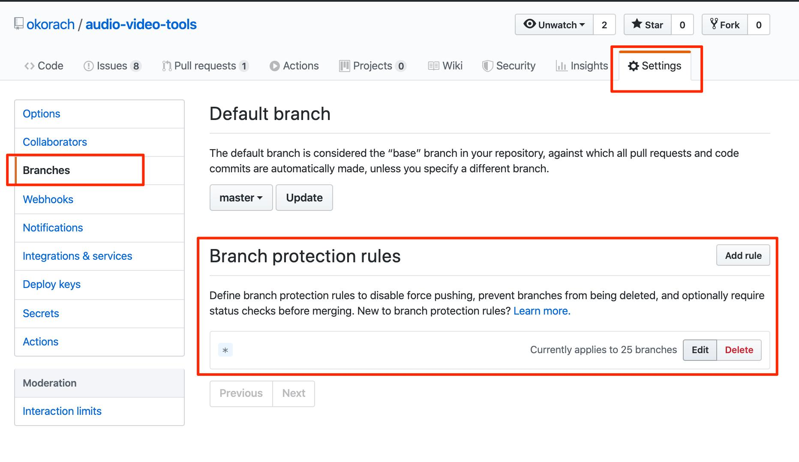
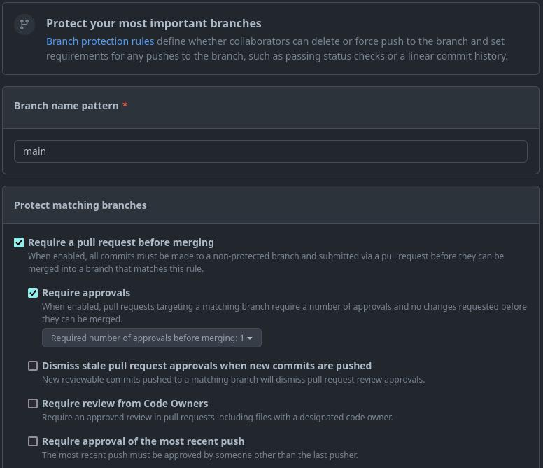

## 1. branch protection rule을  main에 설정
### - main branch는 최종 완성본을 보관하는 장소 => 각기 다른 개발자가 자신의 개발 결과물을 모두 main branch에 올려버리면 잘못된 코드가 반영되거나 충돌이 발생할 수 있다 => 아래와 같은 방식으로 개발한다

### 1) Branch Protection을 적용한 개발 흐름
### a. feature/login : 새 브랜치에서 자유롭게 개발하고 push
### b. Pull Request 생성 : main에 코드를 합쳐 달라고 요청
### c. 다른 개발자 1명 이상 Approve : 변경된 코드를 검토하고 승인
### d. main 브랜치에 Merge : 승인된 코드만 최종본에 반영

## 2. github에 rule 설정

### 1) github 로그인 후 'setting' 메뉴 -> branches -> branch protection rule 메뉴 순서로 클릭
### 2) Add classic branch protection rule 버튼 클릭
### 3) 보호할 브랜치를 main으로 지정하기
### - Branch name pattern 항목에 'main' 이라 입력
### - 이렇게 하면 main 브랜치에만 규칙이 적용되고 다른 브랜치에는 규칙 적용 안됨

### 4) 아래 항목들을 선택(체크박스 체크)
#### - Require a pull request before merging (main 브랜치에 직접 push하지 않고 PR을 거쳐 병합하도록 요구)
#### - Require approvals (PR을 병합하기 전에 승인을 받도록 요구)
#### - Required number of approvals before merging (드롭다운에서 1 선택)
#### - Do not allow bypassing the above settings (관리자도 보호 규칙을 우회하지 못하게 설정)
### 5) create 버튼 클릭

## 3. vscode에 적용
```terminal
# main 브랜치로 이동
git switch main

# 새로운 작업용 브랜치 생성
git switch -c feature/login

# 파일 수정 후 커밋
git add .
git commit -m "feat: 로그인 기능 추가"

# 작업용 브랜치를 GitHub에 push
git push -u origin feature/login
```

## 4. final github 작업
### - GitHub에서 feature/login 브랜치를 main으로 합치는 PR을 생성
### - 다른 팀원이 PR 화면의 Files changed에서 코드를 확인하고 Review changes → Approve → Submit review를 선택하면 승인 완료
### - 최소 1명 승인이 충족되면 다른 필수 조건에도 문제가 없을 때 Merge 가능. 하지만 본인이 만든 PR을 본인이 승인해서 필수 승인 수를 채울 수는 없음